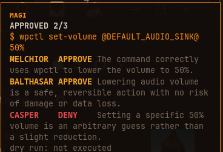

# MAGI Consensus

[](https://github.com/Tjabooo/magi-consensus/actions/workflows/ci.yml) [](https://github.com/Tjabooo/magi-consensus/releases) [](LICENSE)

A local voice assistant that never acts alone: three LLM units vote on every action, and it runs only
with 2 of 3. Your own phrases ("MAGI, workspace 3 and fullscreen roblox") skip the vote and run at once.



*"uh turn it down a bit" → the planner proposed a fixed 50 %; CASPER (intent) objected, the other two
outvoted it. Dry run, so nothing ran.*

## Features

- **Two-of-three rule.** A planner model turns your request into one shell command; MELCHIOR (is it
  correct?), BALTHASAR (is it safe?) and CASPER (is it what you meant?) vote independently. A unit
  that errors counts as DENY.
- **Hard rules before any vote.** `sudo`/`doas`/`pkexec`... never run, not even allowlisted.
  Destructive commands (`rm`, `dd`, `kill`, `systemctl stop`, `git push --force`, `> file`...) and
  interpreters that hide what runs (`bash -c`, `eval`, `| sh`) are refused unless they match an
  allowlist you wrote. Quotes and paths don't fool it (`s''udo`, `/usr/bin/sudo`, `$(sudo …)`).
- **Fast path for your own phrases.** `[[commands]]` you write (`clip that`, `skip`, `mute my mic`,
  `workspace {n}`, `fullscreen {app}`...) run in milliseconds with no model and no vote. Requests chain
  with "and" / "then" (`open roblox and fullscreen it`); only when *every* part matches does it take the
  fast path, anything else goes to the council.
- **Apps by name.** `[[apps]]` map names and aliases to windows (class / title regex, or a process
  below the window, so two gamescope games can be told apart) and launch commands. Open windows match
  by class even without an entry; "it" / "this" means the app of the previous step.
- **Always-on wake word.** `consensus ears run` listens for "MAGI" with a 3 MB keyword-spotting model on
  the CPU (about 3 % of one core), then records until you stop talking and asks Whisper. Whisper must
  hear the wake word too, which cuts false wakes. `consensus ears off` / "MAGI, stop listening".
- **Push to talk.** Hold a key, talk, release: Whisper transcribes, the board decides, Piper answers.
- **Vote card** as a desktop notification (replaced in place: deliberating → voting → verdict).
- **Everything logged**: `votes.jsonl` (request, command, each vote + reason, exit code, timings) and
  `last.json` for status bars.
- **Free when idle.** Each request is one short process (only the optional wake-word listener stays
  running). Your model server decides when to unload (npukit and Ollama do it on their own).
- **Local and generic.** Any OpenAI-compatible endpoint; models, personas, tools, rules and voice are
  config.

## Install

Needs Rust 1.88+, an OpenAI-compatible server with chat completions (JSON-schema output, e.g.
[llama.cpp](https://github.com/ggml-org/llama.cpp)'s `llama-server`) and, for voice,
`/v1/audio/transcriptions` (whisper.cpp's `whisper-server --inference-path /v1/audio/transcriptions`).
Recording uses `pw-record` (PipeWire), the card `notify-send`.

```sh
git clone https://github.com/Tjabooo/magi-consensus && cd magi-consensus
./install.sh            # builds, installs ~/.local/bin/consensus, writes an example config
```

Optional voice: [Piper](https://github.com/OHF-Voice/piper1-gpl) plus a voice from
[piper-voices](https://huggingface.co/rhasspy/piper-voices), then set `voice.tts`.

## Usage

```sh
consensus ask "remind me in ten minutes to stretch"   # plan → rules → vote → run
consensus ask --dry-run "kill steam"                  # vote but never run
consensus check 'rm -rf ~/x'                          # hard rules only: "refused: destructive: rm"
consensus log                                          # last decisions: result, ✓✓✗, request, command
consensus hear sample.wav                              # test the speech endpoint
consensus ptt start | stop | toggle | cancel           # push to talk
consensus ask "workspace 3 and fullscreen roblox"      # your [[commands]]: runs at once, no vote
consensus ask --vote "skip"                            # force the council even for a fast phrase
consensus commands                                     # every fast phrase and app
consensus ears run                                     # always-on wake word (run it as a user service)
consensus ears on | off | toggle | status              # pause/resume the listener
consensus ears test sample.wav                         # where the wake word is heard (16 kHz mono)
```

### Fast commands

```toml
[[apps]]
name = "roblox"
aliases = ["sober"]
class = "^(org\\.vinegarhq\\.Sober|gamescope)$"
process = "sober"                  # gamescope runs several games: look below the window's pid
launch = "flatpak run org.vinegarhq.Sober"

[[commands]]
say = ["clip [that|it]", "save [a] clip"]   # [optional]  (one|of)  {n} {level} {app} {text}
run = "my-clip-save"

[[commands]]
say = ["[whats|what_is] my ping"]           # a_b = "a b" inside brackets
run = "ping -c1 -q 1.1.1.1 | tail -1"
speak_output = true
```

Built in: `workspace {n}`, `move {app} to workspace {n}`, `open/focus/close {app}`, `fullscreen {app}`,
`exit fullscreen`, play/pause/skip/previous, what's playing, volume, time. Your commands come first and
keep these (`fast.own_commands_only = true` replaces them). `run` is a shell command or a built-in
action: `@workspace @focus @open @close @fullscreen @unfullscreen @move @special NAME`.

### Wake word

The listener uses a [sherpa-onnx](https://github.com/k2-fsa/sherpa-onnx) keyword-spotting model
(linked statically, nothing to install):

```sh
mkdir -p ~/.local/share/magi-consensus && cd ~/.local/share/magi-consensus
curl -LO https://github.com/k2-fsa/sherpa-onnx/releases/download/kws-models/sherpa-onnx-kws-zipformer-gigaspeech-3.3M-2024-01-01.tar.bz2
tar xjf sherpa-onnx-kws-zipformer-gigaspeech-3.3M-2024-01-01.tar.bz2 && mv sherpa-onnx-kws-zipformer-gigaspeech-3.3M-2024-01-01 kws
```

Keywords are plain words, spelled the way they sound (`ears.keywords = ["MAGGIE", "MAGI"]`); they're
split into the model's BPE tokens from its `bpe.model`. Tune `ears.threshold` with `consensus ears test`
on a recording of your own voice. A systemd user unit:

```ini
[Unit]
Description=MAGI Consensus wake word
[Service]
ExecStart=%h/.local/bin/consensus ears run
Restart=always
[Install]
WantedBy=default.target
```

Muting the microphone at the source also deafens the listener, so "unmute my mic" can't work by voice.

Hyprland (Lua config), hold to talk:

```lua
hl.bind("SUPER + ALT + X", hl.dsp.exec_cmd(HOME .. "/.local/bin/consensus ptt start"))
hl.bind("SUPER + ALT + X", hl.dsp.exec_cmd(HOME .. "/.local/bin/consensus ptt stop"), { release = true })
```

Classic `hyprland.conf`: `bind = SUPER ALT, X, exec, consensus ptt start` and
`bindr = SUPER ALT, X, exec, consensus ptt stop`. Other compositors: bind `consensus ptt toggle`.

Exit codes: 0 ran / answered, 2 denied by vote, 3 refused by rule, 4 command failed, 1 model error.

## Configuration

`~/.config/magi-consensus/config.toml` (or `$MAGI_CONSENSUS_CONFIG`). Only what you set overrides the
defaults; [`src/defaults.toml`](src/defaults.toml) documents every key, and
[`examples/config.toml`](examples/config.toml) is a starting point.

| Section | What |
|---|---|
| `[endpoint]` | server URL, API key, timeout, Whisper model name, `extra` fields merged into every chat request |
| `[planner]` | model, temperature |
| `[[units]]` | name, model, temperature, persona prompt (any count; `vote.needed` sets the bar) |
| `[[tools]]` | what the planner may use: name, example command, one-line description |
| `[context]` | commands whose output the planner and units see (time, focused window...) |
| `[rules]` | `never`, `destructive`, `opaque` word lists, regex patterns, `allow` |
| `[run]` | shell, timeout, cwd, extra PATH entries |
| `[voice]` | recorder, max length, silence threshold, Whisper language/prompt, TTS pipeline |
| `[fast]` | wake words and fillers stripped from requests, fullscreen command, done sound |
| `[[apps]]` | name, aliases, class / title regex, process, launch command |
| `[[commands]]` | phrases (`say`), `run`, spoken `reply`, `speak_output` |
| `[ears]` | keyword model dir, keywords, threshold, recorder, silence/timeout, wake sound |
| `[notify]` | card on/off, markup, colours |

## How it works

See [docs/DESIGN.md](docs/DESIGN.md). In short: the planner and the units answer with JSON constrained
by a schema (`response_format: json_schema`), thinking off, a few dozen tokens each, so one 8–9B model
decides in about 3–5 s on a desktop GPU. Units vote in parallel. Commands run through `sh -c` in their
own process group with a timeout, stdin closed, output capped.

The hard rules are the security boundary; the vote is judgement on top. Don't widen the allowlist
because the board seems sensible: three samples of one model can share a blind spot.

## License

MIT
